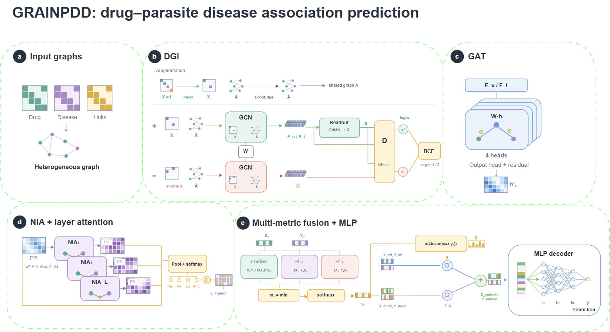

# GRAINPDD

## Flowchart



## Model

GRAINPDD predicts potential drug–parasitic disease associations. It combines enhanced DGI, GAT, NIA, layer attention, multi-metric view fusion, and an MLP predictor.

## Dataset

[Download the ZhangDDA dataset](https://drive.google.com/file/d/1EJvNJxOJJO8K06OKeC5J4W6iDYEloTur/view) and place its files in `Datasets/ZhangDDA/used_data/` before running the commands below.

## Environment

The required environment is:

```text
Python 3.10.16
numpy==1.23.5
pandas==2.2.3
scikit-learn==1.1.2
scipy==1.15.2
torch==1.13.1+cu117
```

For a CPU-only machine, replace `--device cuda` with `--device cpu` in the final command.

## Split the dataset

```bash
python code/split_data.py 5 ZhangDDA 1 1
```

## Run GRAINPDD

```bash
python code/command_optimal.py --dataName ZhangDDA --exp_name optimal_cross --seed_cross 1 --seed_indent 1 --device cuda --lossType MF_all --sigmoid_flag 1 --use_improvements 1
```
